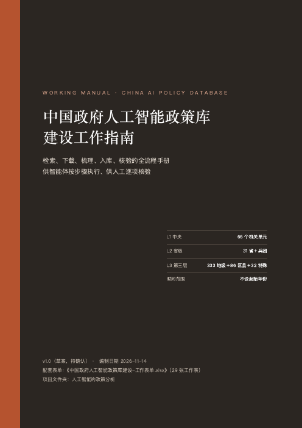
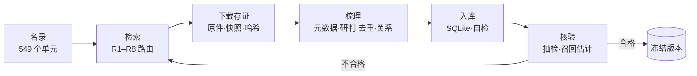

# 中国政府人工智能政策库

**AI Policy in China** · 中央、省级、地级三个层级的人工智能政策文本库


这个仓库存放政策库的建设规程、执行包和已经采集的数据。检索和整理由智能体执行，人工负责抽检和裁决，每份文件都能追溯到官方原件。

- 📘 **[工作指南 PDF（v1.0，53 页）](docs/AI-Policy-DB-Guide_v1.0.pdf)**
- 📊 **[中央层运行报告 PDF（2026-11-15，34 页，含 652 条政策清单）](docs/reports/central_report_20261115.pdf)**
- 🗂 **[中央层数据](data/)**：政策清单、来源记录、检索日志、正文
- 📦 **[中央层政策原件（Release 附件，约 790 MB）](https://github.com/XuYiheng-code/AI--policy-in-China/releases/tag/data-central-20261115)**：818 条记录的官网原件与附件
- 🗺 **省级（11 个单元，独立 A/B 政策合计 3,523 份）**：每省有现状说明 PDF、数据文件夹和原件 Release

| 省份 | 底稿 | 独立政策 | A / B | 现状说明 | 数据 | 原件 |
|---|---|---:|---|---|---|---|
| 浙江省 | 2026-11-16 第二轮 | 397 | 60 / 337 | [PDF](docs/reports/zhejiang_report_20261116.pdf) | [zhejiang/](data/provincial/zhejiang/) | [Release](https://github.com/XuYiheng-code/AI--policy-in-China/releases/tag/data-zhejiang-20261116) |
| 北京市 | 2026-11-27 | 427 | 110 / 317 | [PDF](docs/reports/beijing_report_20261127.pdf) | [beijing/](data/provincial/beijing/) | [Release](https://github.com/XuYiheng-code/AI--policy-in-China/releases/tag/data-beijing-20261127)（490 MB） |
| 上海市 | 2026-11-23 | 278 | 66 / 212 | [PDF](docs/reports/shanghai_report_20261123.pdf) | [shanghai/](data/provincial/shanghai/) | [Release](https://github.com/XuYiheng-code/AI--policy-in-China/releases/tag/data-shanghai-20261123)（432 MB） |
| 江苏省 | 2026-11-16 第二轮 | 199 | 63 / 136 | [PDF](docs/reports/jiangsu_report_20261116.pdf) | [jiangsu/](data/provincial/jiangsu/) | [Release](https://github.com/XuYiheng-code/AI--policy-in-China/releases/tag/data-jiangsu-20261116)（197 MB） |
| 安徽省 | 2026-11-23 | 320 | 57 / 263 | [PDF](docs/reports/anhui_report_20261123.pdf) | [anhui/](data/provincial/anhui/) | [Release](https://github.com/XuYiheng-code/AI--policy-in-China/releases/tag/data-anhui-20261123)（422 MB） |
| 福建省 | 2026-11-23 第二轮 | 471 | 109 / 362 | [PDF](docs/reports/fujian_report_20261123.pdf) | [fujian/](data/provincial/fujian/) | [Release](https://github.com/XuYiheng-code/AI--policy-in-China/releases/tag/data-fujian-20261123-r2)（1.1 GB） |
| 江西省 | 2026-11-24 第二轮 | 312 | 53 / 259 | [PDF](docs/reports/jiangxi_report_20261124.pdf) | [jiangxi/](data/provincial/jiangxi/) | [Release](https://github.com/XuYiheng-code/AI--policy-in-China/releases/tag/data-jiangxi-20261124)（1.4 GB） |
| 山东省 | 2026-11-16 第二轮 | 254 | 60 / 194 | [PDF](docs/reports/shandong_report_20261116.pdf) | [shandong/](data/provincial/shandong/) | [Release](https://github.com/XuYiheng-code/AI--policy-in-China/releases/tag/data-shandong-20261123)（150 MB） |
| 湖南省 | 2026-11-16 | 370 | 70 / 300 | [PDF](docs/reports/hunan_report_20261116.pdf) | [hunan/](data/provincial/hunan/) | [Release](https://github.com/XuYiheng-code/AI--policy-in-China/releases/tag/data-hunan-20261123)（419 MB） |
| 广东省 | 2026-11-26 | 329 | 108 / 221 | [PDF](docs/reports/guangdong_report_20261126.pdf) | [guangdong/](data/provincial/guangdong/) | [Release](https://github.com/XuYiheng-code/AI--policy-in-China/releases/tag/data-guangdong-20261126)（1.0 GB） |
| 陕西省 | 2026-11-24 | 166 | 39 / 127 | [PDF](docs/reports/shaanxi_report_20261125.pdf) | [shaanxi/](data/provincial/shaanxi/) | [Release](https://github.com/XuYiheng-code/AI--policy-in-China/releases/tag/data-shaanxi-20261125)（103 MB） |

<br clear="right">

## 进度

| 阶段 | 内容 | 状态 |
|---|---|:---:|
| P0 准备 | 执行环境、名录、建库脚本 | 🔄 基本就绪，验收门 G0 未过 |
| P1 试点 | 11 个单元全流程，校准口径与提示词 | ⬜ 未做（先行开展了中央采集） |
| P2 中央 | 66 个机关单元 | 🔄 采集中，见下方摘要 |
| P3 省级 | 32 个单元 | 🔄 浙江、北京、上海、江苏、安徽、福建、江西、山东、湖南、广东、陕西 11 个单元已整理（均未验收），其余未开始 |
| P4 第三层 | 451 个单元，按省分批 | ⬜ |
| P5 全库质检 | 去重、关系、召回估计、冻结 v1.0 | ⬜ |

## 中央层执行摘要（快照 2026-11-15 02:31）

> 以下数字均为智能体与脚本的初判，**人工核验 0 条**，不能作为“中央人工智能政策总数”引用。

| 环节 | 数量 | 说明 |
|---|---:|---|
| 检索题录 | 18,781 | 含跨库重复，13,425 条尚未初筛 |
| 登记来源记录 | 818 | 已下载存证；同一文件在不同网站各算一条 |
| 暂判 A/B 级 | 685 | A 级 168、B 级 517；正文完整 696 条（全部记录） |
| 同文归并后主记录 | **652** | 主库 636 条；只合并了已确认的 27 组同文，仍偏高 |
| 人工核验通过 | 0 | 尚未开始 |

**收进来的是什么**（636 条主库主记录）

- 时间：集中在近三年，2024—2026 年 339 条，占 53%；2015 年及以前仅 10 条，早期公报和历史机关名称还没补检。
- 领域：科技研发（200）、产业发展（185）、政府治理与监管（183）居前，其次是伦理与安全治理、制造、医疗卫生。
- 主体与形式：部门单独发文占多数；形式以意见类、通知类、方案类、规划纲要为主，征集申报和名单公示等实施类文件单列 160 条。
- 登记量最多的机关：工信部、国务院、教育部、网信办、科技部。

**主要缺口**

- 66 个机关单元**全部未关闭**。现有记录主要来自国务院政策文件库、国务院公报、北大法宝和法律法规库这几个跨机关大库。
- 部委官网站内检索（R2）**62 个单元为 0 条日志**；上位依据反查（R6）24 个单元、通用搜索（R7）22 个单元为 0 条日志。部委自行发布、未进国务院政策库的文件最可能在这里漏掉。
- 相关性待定 97 条，A/B 原件需补源 48 条，问题单待处理 699 条。

**下一步**

1. 补 R2 站内检索，先做手册点名的数据局、工信部、科技部，再做登记量大的网信办、教育部。
2. 从 818 条记录中抽第一批做人工核验，过验收门 G0。
3. R2、R6 补齐后做全库去重，再确定中央层政策份数。

## 省级进度（2026-11-23）

> 十个省级单元的独立 A/B 政策合计 3,096 份（A 级 685、B 级 2,411）。数字均为智能体初判，**人工核验 0 条**，没有一个单元验收。各省数量差别主要来自检索覆盖，不能当作各省政策量的比较。

| 省份 | 独立政策 | A 级 | 原件核齐 | 主要缺口 |
|---|---:|---:|---|---|
| 浙江 | 397 | 60 | 96 份（24%） | 58 份 B/C 边界待人工裁决；356 个 URL 需人工下载 |
| 北京 | 427 | 110 | 357 份（脚本判断，未逐份对原件） | 执行与把关为同一模型，没有独立盲审；18 项边界、129 条待定（经开区 128 条，层级口径未定）等裁决；359 条法宝题录没对上官网件；公报逐期目录 403、16 个部门站停站 |
| 上海 | 278 | 66 | 277 份 | 1,154 份门户原件已下载未读、7,708 个部门 URL 未取文、1,812 条题录未筛 |
| 江苏 | 199 | 63 | — | 门户、公报 403；浙江影子清单 459 条中 435 条被拦截 |
| 安徽 | 320 | 57 | 320 份（缺件文件放在待定） | 门户、公报 403；5,356 条题录中 4,603 条未读全文；9 份待定 |
| 福建 | 471 | 109 | 374 份（79%） | 命中材料已逐份审读；98 份原件未齐，51 待定、22 组 B/C 边界待裁决，省委与省政府部门网站未单独检索 |
| 江西 | 312 | 53 | 1 份 | 第二轮发现 58 份新文件待登记；2017 年 AI 若干措施等 5 份关键原件缺；2025 年前无 A 级专项；305 条候选待定 |
| 山东 | 254 | 60 | — | 门户 403；原件与附件缺口 |
| 湖南 | 370 | 70 | 29 份（8%） | B 级未按浙江口径复核；整期公报待转换 |
| 广东 | 329 | 108 | 309 份（脚本判断，未逐份对原件） | 执行与把关为同一模型，没有独立盲审；28 项边界、19 条待定等裁决；法宝全量 5,780 条题录中 338 份本级文件没对上官网件；横琴合作区层级未定 |
| 陕西 | 166 | 39 | 166 份（执行方口径：公开版本已保存） | 7 份边界政策、9 条待定等裁决；七条路由未关闭；132 份法宝题录没对上官网件 |

各省数据文件夹的文件：`policies.csv`（独立政策，一行一份）、`source_records.csv`（来源记录）、`route_status.csv`（R1–R7 检索状态）、`search_log.csv`（检索日志，山东无）、`agency_coverage.csv`（机关覆盖）、`qc_*.csv`（重复、日期、相似文件核查）、`texts/`（正文）。北大法宝题录清单不公开。

## 浙江省执行摘要（第二轮，快照 2026-11-16）

> 数字均为智能体初判，**人工核验 0 条**，单元未验收。完整说明见[浙江省现状说明 PDF](docs/reports/zhejiang_report_20261116.pdf)。

| 环节 | 数量 | 说明 |
|---|---:|---|
| 登记来源记录 | 559 | 同一文件在门户、部门网站、公报、法宝各算一条 |
| 独立政策 | **397** | A 级 60、B 级 337；第一轮的 459 份经 B 级口径复核收紧 |
| B/C 边界待裁决 | 58 | 只在列举外有一句 AI 表述、缺项目或指标的文件，等人工按统一规则裁决 |
| 原件与附件核齐 | 96 | A 级 28；356 个被拦截的 URL 需要人工下载 |
| 人工核验通过 | 0 | 尚未开始 |

**第二轮做了什么**：B 级里 ai_hits ≤ 2 或标题像课题、研修、普法、名单的 200 份逐份复核（维持 B 136、改 C 6、待定 58）；补编浙政办发〔2023〕65 号《关于加快人工智能产业发展的指导意见》和 2026 年政府工作报告；合并第一轮发现的 10 对重复；99 份按官网页面写回网站发布日期并改号（新旧编号见 `doc_id_changes.csv`）。

**收进来的是什么**：2025—2026 年的文件占近一半；脉络是 2017 年省级总体规划 → 2020 年 AI 标准化技术委员会 → 2021—2022 年揭榜挂帅与杭州先导区 → 2025 年起“人工智能+”行业方案、算力券、生成式 AI 备案公告。A 级集中在经信厅、发改委、科技厅、市场监管局、教育厅和省网信办。

**主要缺口**：R1—R7 均未关闭；29 个机关没有部门网站三词检索日志；A 级核齐原件仍是 28 份；自检 V01、V02、V11、V15 有阻断项。

## 江苏省执行摘要（第二轮，快照 2026-11-16）

> 数字均为智能体初判，**人工核验 0 条**，单元未验收。完整说明见[江苏省现状说明 PDF](docs/reports/jiangsu_report_20261116.pdf)。

| 环节 | 数量 | 说明 |
|---|---:|---|
| 登记来源记录 | 207 | 含 7 条 C 级 |
| 独立政策 | **199** | A 级 63、B 级 136；第二轮把已读过的 17 期生成式 AI 备案公告、18 个 B 级线索包和 10 条待定记录补证入库 |
| 未编号线索包 | 43 | 按标题归并 39 份（A 7、B 28、待定 4），不计入 |
| 原件核齐 | 174 | 待核 11、缺附件 14 |
| 人工核验通过 | 0 | 尚未开始 |

**和浙江比**：A 级已经相当（63 对 60），差距在 B 级（136 对 337）。用浙江 459 份政策做影子清单逐条外搜，找到同类 24 条、确认没有 0 条、被官网拦截 435 条；省政府门户 31 个检索词全页完成 0 个，384 期公报一期未开。B 级差距主要是访问受限造成的，需要人工在浏览器里补。


| 层级 | 检索单元 | 说明 |
|---|---:|---|
| L1 中央 | 66 | 党中央、全国人大、国务院及其部门，按机关逐个检索 |
| L2 省级 | 32 | 31 个省、自治区、直辖市，加新疆生产建设兵团 |
| L3 第三层 | 451 | 333 个地级行政区、86 个直辖市区县、32 个省直管县级单元 |
| **合计** | **549** | 县级不普查，偶遇时登记 |

主题覆盖人工智能政策的全部领域：产业、科技研发、政务与治理、算法与内容监管、教育、医疗、交通、人才、算力等。检索不设起始年份，2015 年以前的文件单独标记为“前史”。

**进库标准**按文件中有没有“以人工智能为对象的独立任务”判定，不看词频：

| 等级 | 含义 | 处理 |
|:---:|---|---|
| A | 以人工智能为主题的文件 | 全文进主库 |
| B | 主题不是人工智能，但有专门的章、节、条或具体任务 | 全文进主库 |
| C | 只在列举中提到人工智能 | 只登记，不进主库 |
| X | 没有人工智能内容 | 排除，保留检索记录 |

政府工作报告、标准、司法文件进辅库；新闻、解读进线索库；年度报告、工作总结排除。征集申报、名单公示等实施类文件和转发文件进主库，但单独标注。

## 怎么建



- **执行**：Codex 负责检索、下载、抽取和初判，按 `AGENTS.md` 与 `rules.json` 执行
- **复核**：Claude 做独立复核和“0 份”单元审查，检查者与执行者不用同一个模型
- **核验**：人工按批抽检，关键字段错误率 ≤ 2% 才放行；用已知项回收和双路独立检索估计召回率

## 质量要求

- 每一次检索都记日志，包括 0 命中；某地“没有政策”的结论要经过二次独立检索和人工复核
- 每份文件保存官方链接、获取时间、原件、网页快照和 SHA-256
- A、B 级判定必须附逐字引文和位置
- 口径、提示词、模型版本都有版本号，冻结后按月增量更新

## 仓库结构

```
README.md
docs/
  AI-Policy-DB-Guide_v1.0.pdf      工作指南
  reports/                         各层级运行报告（PDF 快照）
data/
  README.md                        数据说明：文件、字段、计数口径、使用限制
  central/                         中央层数据：政策清单、来源记录、检索日志、正文
  provincial/zhejiang/             浙江省数据：独立政策清单、来源记录、检索日志、B 级复核与待裁决清单、正文
  provincial/jiangsu/              江苏省数据：独立政策清单、登记记录、检索日志、影子清单对照、待人工清单、正文
  provincial/{shanghai,anhui,fujian,shandong,hunan}/  其他省级数据：独立政策清单、来源记录、检索状态、质量核查、正文

执行包（Codex 以仓库根目录为工作目录）
AGENTS.md                          执行说明：依据、硬性规则、目录约定、每次运行的开始与结束动作
rules.json                         全部口径的机器可读版
schema.sql                         SQLite 建表语句
VERSION                            执行包版本号
prompts/P1.md … P8.md              各环节提示词
roster/                            549 个检索单元、机关模板、召回测试已知项
legacy/oldlib_diagnosis.csv        旧库 673 个文件的诊断与建议去向
assets/                            图片
```

口径只在一处修改：先改指南的口径数据，再同时重新生成指南、表单和执行包，不直接改 `rules.json` 或提示词。原件和网页快照体积较大，按层级打包为 Release 附件发布，不进 Git 历史；数据库和工作目录保存在本地。

---

<sub>文本均来自各级政府公开发布的信息，以官方原件为准。</sub>
