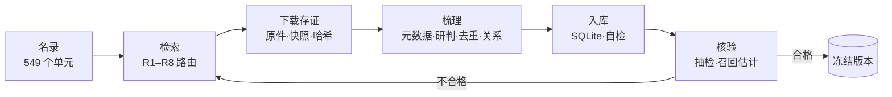

# 中国政府人工智能政策库

**AI Policy in China** · 中央、省级、地级三个层级的人工智能政策文本库


这个仓库存放政策库的建设规程、执行包和已经采集的数据。检索和整理由智能体执行，人工负责抽检和裁决，每份文件都能追溯到官方原件。

- 📘 **[工作指南 PDF（v1.0，53 页）](docs/AI-Policy-DB-Guide_v1.0.pdf)**
- 📊 **[中央层运行报告 PDF（2026-11-15，34 页，含 652 条政策清单）](docs/reports/central_report_20261115.pdf)**
- 🗂 **[中央层数据](data/)**：政策清单、来源记录、检索日志、正文
- 📦 **[中央层政策原件（Release 附件，约 790 MB）](https://github.com/XuYiheng-code/AI--policy-in-China/releases/tag/data-central-20261115)**：818 条记录的官网原件与附件
- 📊 **[浙江省现状说明 PDF（2026-11-15，30 页，含 459 份政策清单）](docs/reports/zhejiang_report_20261115.pdf)**
- 🗂 **[浙江省数据](data/provincial/zhejiang/)**：独立政策清单、来源记录、检索日志、质量核查、正文
- 📦 **[浙江省政策原件（Release 附件，约 336 MB）](https://github.com/XuYiheng-code/AI--policy-in-China/releases/tag/data-zhejiang-20261115)**：557 条记录的原件与线索包
- 📊 **[江苏省现状说明 PDF（2026-11-15，17 页，含 152 份政策清单）](docs/reports/jiangsu_report_20261115.pdf)**
- 🗂 **[江苏省数据](data/provincial/jiangsu/)**：独立政策清单、登记记录、检索日志、线索包裁决建议、正文
- 📦 **[江苏省政策原件（Release 附件，约 194 MB）](https://github.com/XuYiheng-code/AI--policy-in-China/releases/tag/data-jiangsu-20261115)**：170 条登记记录与 86 个线索包的原件

<br clear="right">

## 进度

| 阶段 | 内容 | 状态 |
|---|---|:---:|
| P0 准备 | 执行环境、名录、建库脚本 | 🔄 基本就绪，验收门 G0 未过 |
| P1 试点 | 11 个单元全流程，校准口径与提示词 | ⬜ 未做（先行开展了中央采集） |
| P2 中央 | 66 个机关单元 | 🔄 采集中，见下方摘要 |
| P3 省级 | 32 个单元 | 🔄 浙江、江苏完成首轮归集（未验收），其余 30 个进行中或未开始 |
| P4 第三层 | 451 个单元，按省分批 | ⬜ |
| P5 全库质检 | 去重、关系、召回估计、冻结 v1.0 | ⬜ |

## 中央层执行摘要（快照 2026-11-15 02:31）

> 以下数字均为智能体与脚本的初判，**人工核验 0 条**，不能作为“中央人工智能政策总数”引用。

| 环节 | 数量 | 说明 |
|---|---:|---|
| 检索题录 | 18,781 | 含跨库重复，13,425 条尚未初筛 |
| 登记来源记录 | 818 | 已下载存证；同一文件在不同网站各算一条 |
| 暂判 A/B 级 | 685 | A 级 168、B 级 517；正文完整 696 条（全部记录） |
| 同文归并后主记录 | **652** | 主库 636 条；只合并了已确认的 27 组同文，仍偏高 |
| 人工核验通过 | 0 | 尚未开始 |

**收进来的是什么**（636 条主库主记录）

- 时间：集中在近三年，2024—2026 年 339 条，占 53%；2015 年及以前仅 10 条，早期公报和历史机关名称还没补检。
- 领域：科技研发（200）、产业发展（185）、政府治理与监管（183）居前，其次是伦理与安全治理、制造、医疗卫生。
- 主体与形式：部门单独发文占多数；形式以意见类、通知类、方案类、规划纲要为主，征集申报和名单公示等实施类文件单列 160 条。
- 登记量最多的机关：工信部、国务院、教育部、网信办、科技部。

**主要缺口**

- 66 个机关单元**全部未关闭**。现有记录主要来自国务院政策文件库、国务院公报、北大法宝和法律法规库这几个跨机关大库。
- 部委官网站内检索（R2）**62 个单元为 0 条日志**；上位依据反查（R6）24 个单元、通用搜索（R7）22 个单元为 0 条日志。部委自行发布、未进国务院政策库的文件最可能在这里漏掉。
- 相关性待定 97 条，A/B 原件需补源 48 条，问题单待处理 699 条。

**下一步**

1. 补 R2 站内检索，先做手册点名的数据局、工信部、科技部，再做登记量大的网信办、教育部。
2. 从 818 条记录中抽第一批做人工核验，过验收门 G0。
3. R2、R6 补齐后做全库去重，再确定中央层政策份数。

## 浙江省执行摘要（快照 2026-11-15）

> 首个省级单元。数字均为智能体初判，**人工核验 0 条**，单元未验收。完整说明见[浙江省现状说明 PDF](docs/reports/zhejiang_report_20261115.pdf)。

| 环节 | 数量 | 说明 |
|---|---:|---|
| 登记来源记录 | 557 | 同一文件在门户、部门网站、公报、法宝各算一条 |
| 进入主库的来源记录 | 496 | A/B 级正式政策来源 |
| 同文组 | 469 | 正文逐字相等才合并 |
| 独立政策 | **459** | A 级 59、B 级 400；逐对比对正文后再合并 10 对来源不同的同一政策 |
| 原件与附件核齐 | 111 | 待核 176，缺附件 172 |
| 人工核验通过 | 0 | 尚未开始 |

**收进来的是什么**

- 时间：2025—2026 年 214 份，占 47%；A 级 59 份中有 38 份出自这两年。2021 年因各领域“十四五”规划集中发布，B 级有一个小高峰。
- 脉络：2017 年省级总体规划 → 2020 年 AI 标准化技术委员会 → 2021—2022 年揭榜挂帅与杭州先导区 → 2025 年起各行业“人工智能+”方案、算力券、生成式 AI 备案公告密集出台。
- 发文机关：省政府和省政府办公厅最多，多为 B 级综合性规划；A 级集中在经信厅、发改委、科技厅、市场监管局、教育厅和省网信办。

**11-15 复核与补查**

- 无日期政策 32 → 2 份，补出的日期标注依据和可信度（见 `qc_date_supplement.csv`）。
- 三份 A 级征求意见稿查正式版：《关于加快人工智能产业发展的指导意见》找到（浙政办发〔2023〕65号，原发页面已 404，原件存线索包待编目）；《“人工智能+”行动计划（2024—2027年）》和《推动智能体创新应用的行动方案》未见正式版。另发现 2 份 2026 年新线索待补采。
- 以上调整只写在 `qc_*`、`followup_*` 三个文件里，没有改动来源记录本身。

**主要缺口**：R1—R7 七条路由全部未关闭；56 个机关里 36 个没有单独的部门网站检索；18 项自检中 V01、V02、V11、V13 四项阻断未过。

## 江苏省执行摘要（快照 2026-11-15）

> 数字均为智能体初判，**人工核验 0 条**，单元未验收。完整说明见[江苏省现状说明 PDF](docs/reports/jiangsu_report_20261115.pdf)。

| 环节 | 数量 | 说明 |
|---|---:|---|
| 政策登记记录 | 170 | 含 7 条 C 级、10 条待定（原件不全，退出主库） |
| 进入主库 | 153 | A/B 级，原件全部核齐 |
| 独立政策 | **152** | A 级 39、B 级 113；正文查重合并 1 对；数字经济促进条例 2022 原版与 2025 修正版分别计 |
| 库外待裁决 | 74 | 86 个已审线索包归并后：A 级 23（含 17 期生成式 AI 备案公告）、B 级 44、B/C 边界 7 |
| 人工核验通过 | 0 | 尚未开始 |

**收进来的是什么**

- 时间：2026 年 72 份，占 47%；A 级 39 份中 26 份出自 2026 年。2026 年 1 月省政府《“人工智能＋”行动方案》之后，制造、住建、消费、电商、交通等行业方案集中出台。
- 发文机关：省工信厅 42 份（A 级 13）居首，其次是教育厅、人社厅、数据局。

**这个数偏小，不能和浙江比数量**：省政府门户关键词检索在接口 403 后基本没做，384 期公报没有逐期翻；北大法宝 1,155 条题录有 372 条未筛、255 条未定位全文；另有 74 份已读材料因署名或来源问题留在线索包。

## 收什么

| 层级 | 检索单元 | 说明 |
|---|---:|---|
| L1 中央 | 66 | 党中央、全国人大、国务院及其部门，按机关逐个检索 |
| L2 省级 | 32 | 31 个省、自治区、直辖市，加新疆生产建设兵团 |
| L3 第三层 | 451 | 333 个地级行政区、86 个直辖市区县、32 个省直管县级单元 |
| **合计** | **549** | 县级不普查，偶遇时登记 |

主题覆盖人工智能政策的全部领域：产业、科技研发、政务与治理、算法与内容监管、教育、医疗、交通、人才、算力等。检索不设起始年份，2015 年以前的文件单独标记为“前史”。

**进库标准**按文件中有没有“以人工智能为对象的独立任务”判定，不看词频：

| 等级 | 含义 | 处理 |
|:---:|---|---|
| A | 以人工智能为主题的文件 | 全文进主库 |
| B | 主题不是人工智能，但有专门的章、节、条或具体任务 | 全文进主库 |
| C | 只在列举中提到人工智能 | 只登记，不进主库 |
| X | 没有人工智能内容 | 排除，保留检索记录 |

政府工作报告、标准、司法文件进辅库；新闻、解读进线索库；年度报告、工作总结排除。征集申报、名单公示等实施类文件和转发文件进主库，但单独标注。

## 怎么建



- **执行**：Codex 负责检索、下载、抽取和初判，按 `AGENTS.md` 与 `rules.json` 执行
- **复核**：Claude 做独立复核和“0 份”单元审查，检查者与执行者不用同一个模型
- **核验**：人工按批抽检，关键字段错误率 ≤ 2% 才放行；用已知项回收和双路独立检索估计召回率

## 质量要求

- 每一次检索都记日志，包括 0 命中；某地“没有政策”的结论要经过二次独立检索和人工复核
- 每份文件保存官方链接、获取时间、原件、网页快照和 SHA-256
- A、B 级判定必须附逐字引文和位置
- 口径、提示词、模型版本都有版本号，冻结后按月增量更新

## 仓库结构

```
README.md
docs/
  AI-Policy-DB-Guide_v1.0.pdf      工作指南
  reports/                         各层级运行报告（PDF 快照）
data/
  README.md                        数据说明：文件、字段、计数口径、使用限制
  central/                         中央层数据：政策清单、来源记录、检索日志、正文
  provincial/zhejiang/             浙江省数据：独立政策清单、来源记录、检索日志、质量核查、正文
  provincial/jiangsu/              江苏省数据：独立政策清单、登记记录、检索日志、线索包裁决建议、正文

执行包（Codex 以仓库根目录为工作目录）
AGENTS.md                          执行说明：依据、硬性规则、目录约定、每次运行的开始与结束动作
rules.json                         全部口径的机器可读版
schema.sql                         SQLite 建表语句
VERSION                            执行包版本号
prompts/P1.md … P8.md              各环节提示词
roster/                            549 个检索单元、机关模板、召回测试已知项
legacy/oldlib_diagnosis.csv        旧库 673 个文件的诊断与建议去向
assets/                            图片
```

口径只在一处修改：先改指南的口径数据，再同时重新生成指南、表单和执行包，不直接改 `rules.json` 或提示词。原件和网页快照体积较大，按层级打包为 Release 附件发布，不进 Git 历史；数据库和工作目录保存在本地。

---

<sub>文本均来自各级政府公开发布的信息，以官方原件为准。</sub>
