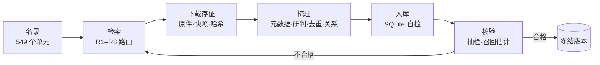

# 中国政府人工智能政策库

**AI Policy in China** · 中央、省级、地级三个层级的人工智能政策文本库


这个仓库用来存放政策库的建设规程、检索与核验记录，以及后续的政策编码数据。检索和整理由多个智能体执行，人工负责抽检和裁决，每一份文件都能追溯到官方原件。

📘 **[下载工作指南 PDF（v1.0，53 页）](docs/AI-Policy-DB-Guide_v1.0.pdf)**

<br clear="right">

## 收什么

| 层级 | 检索单元 | 说明 |
|---|---:|---|
| L1 中央 | 66 | 党中央、全国人大、国务院及其部门，按机关逐个检索 |
| L2 省级 | 32 | 31 个省、自治区、直辖市，加新疆生产建设兵团 |
| L3 第三层 | 451 | 333 个地级行政区、86 个直辖市区县、32 个省直管县级单元 |
| **合计** | **549** | 县级不普查，偶遇时登记 |

主题覆盖人工智能政策的全部领域：产业、科技研发、政务与治理、算法与内容监管、教育、医疗、交通、人才、算力等。检索不设起始年份，2015 年以前的文件单独标记为“前史”。

**进库标准**按文件中有没有“以人工智能为对象的独立任务”判定，不看词频：

| 等级 | 含义 | 处理 |
|:---:|---|---|
| A | 以人工智能为主题的文件 | 全文进主库 |
| B | 主题不是人工智能，但有专门的章、节、条或具体任务 | 全文进主库 |
| C | 只在列举中提到人工智能 | 只登记，不进主库 |
| X | 没有人工智能内容 | 排除，保留检索记录 |

政府工作报告、标准、司法文件进辅库；新闻、解读进线索库；年度报告、工作总结排除。

## 怎么建



- **执行**：Codex 负责检索、下载、抽取和初判，按 `AGENTS.md` 与 `rules.json` 执行
- **复核**：Claude 做独立复核和“0 份”单元审查，检查者与执行者不用同一个模型
- **核验**：人工按批抽检，关键字段错误率 ≤ 2% 才放行；用已知项回收和双路独立检索估计召回率

## 质量要求

- 每一次检索都记日志，包括 0 命中；某地“没有政策”的结论要经过二次独立检索和人工复核
- 每份文件保存官方链接、获取时间、原件、网页快照和 SHA-256
- A、B 级判定必须附逐字引文和位置
- 口径、提示词、模型版本都有版本号，冻结后按月增量更新

## 进度

| 阶段 | 内容 | 状态 |
|---|---|:---:|
| P0 准备 | 执行环境检查、名录核对、建库脚本 | ⏳ 进行中 |
| P1 试点 | 11 个单元全流程，校准口径与提示词 | ⬜ |
| P2 中央 | 66 个机关单元 | ⬜ |
| P3 省级 | 32 个单元 | ⬜ |
| P4 第三层 | 451 个单元，按省分批 | ⬜ |
| P5 全库质检 | 去重、关系、召回估计、冻结 v1.0 | ⬜ |

## 仓库结构

```
AGENTS.md                 执行说明：依据优先级、十条硬性规则、目录约定、每次运行的开始与结束动作
rules.json                全部口径的机器可读版：字段字典、相关性分级、去向、判例、词表、路由、自检、抽检、验收门
schema.sql                SQLite 建表语句
VERSION                   执行包版本号
prompts/P1.md … P8.md     各环节提示词（建档、检索、下载、抽取、研判、去重、复核、0 份审查）
roster/units.csv          549 个检索单元
roster/agency_templates.csv  省级与第三层要查的机关
roster/known_items.csv    召回测试用的已知项（检索运行不得读取；文号日期待核）
legacy/oldlib_diagnosis.csv  旧库 673 个文件的诊断与建议去向
docs/                     工作指南 PDF
assets/                   图片
```

克隆本仓库后，仓库根目录就是 Codex 的工作目录。口径只在一处修改：先改指南的口径数据，再同时重新生成指南、表单和执行包，不直接改 `rules.json` 或提示词。检索日志、数据库和文本库等数据目录（`01_roster/` 至 `09_aux/`）在试点开始后加入。

---

<sub>文本均来自各级政府公开发布的信息，以官方原件为准。</sub>
